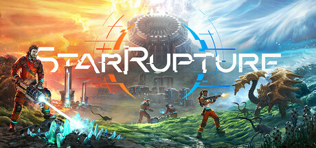

**StarRupture is a space strategy game combining real-time fleet combat with turn-based resource management.**

---

## 📖 About

StarRupture is a space strategy game combining real-time fleet combat with turn-based resource management. You command fleets through contested star systems, managing fuel, crew morale, and political alliances across a procedurally generated galaxy.

## ⚠️ Problems Without Trainer

| Problem | Status |
|---------|--------|
| Fuel reserves run out in hostile territories with no nearby resupply points | ✅ Solved |
| Political alliance shifts trigger fleet betrayals during critical campaigns | ✅ Solved |
| Research costs for advanced technologies require abandoning combat expansion | ✅ Solved |
| Fleet morale drops cascade during losses wiping combat effectiveness buffs | ✅ Solved |
| Enemy faction tech advantages widen rapidly if early research is misprioritized | ✅ Solved |

## ✅ Solution

The **StarRupture Trainer** solves all these issues, giving you complete control so you can focus on enjoying the game.

## 🎯 Features

- Unlimited Resources / Currency
- God Mode / Invincibility
- Instant Skill & Ability Cooldown
- One-Hit Kill
- Freeze Timers
- Unlock All Items & Achievements
- Custom Speed Multiplier
- Infinite Stamina / Energy

## 🚀 Quick Start

1. **Disable Windows Defender** temporarily (trainer may trigger false positive)
2. Get the trainer from the button above
3. Launch StarRupture
4. Run the trainer as Administrator
5. Use the hotkeys to activate cheats in-game

## 💎 Free vs Pro

| Feature | Free | Pro |
|---------|------|-----|
| God Mode | ✅ | ✅ |
| Unlimited Resources | ✅ | ✅ |
| Advanced Cheats | ❌ | ✅ |
| Auto-Updates | ❌ | ✅ |
| Priority Support | ❌ | ✅ |

## 💻 Requirements

- Windows 10 / 11 (64-bit)
- StarRupture (any version)
- .NET Framework 4.8+
- DirectX 11+

## 🍎 macOS

## ⚖️ Legal

Educational and single-player use only.

---

